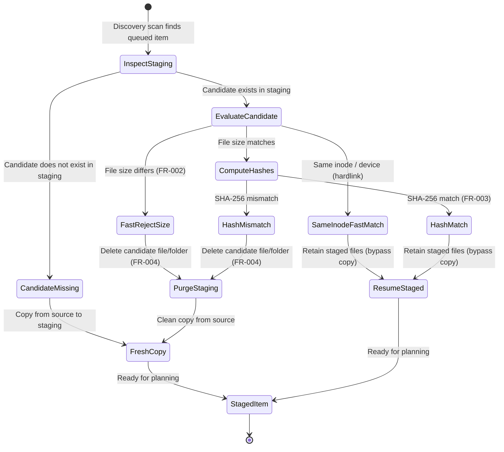
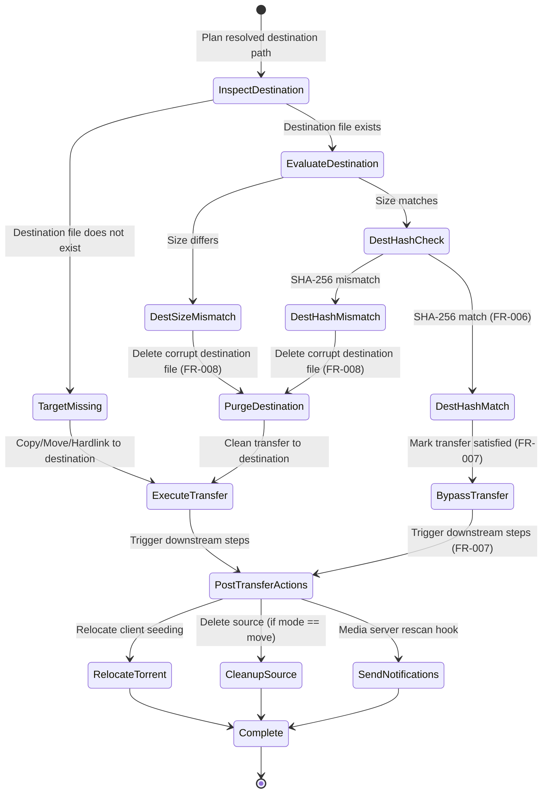

# Data Model: Fast Failure Recovery and Transfer Resumption

**Feature Branch**: `011-resume-failed-transfers`
**Date**: 2026-10-15
**Spec Reference**: [spec.md](spec.md)

---

## 1. Domain Entities & Schemas

### VerificationStatus (Enum)

Represents the granular integrity evaluation state between a source file/release and a candidate staging or destination file/release.

| Value | Description | Implication |
|---|---|---|
| `MATCH` | Target file(s) exist, file sizes match, and content hashes (or inodes) match exactly. | Safe to resume; bypass transfer. |
| `SIZE_MISMATCH` | Target file exists, but file size differs from source. | Corrupt or partial file; fast purge and restart without hashing. |
| `HASH_MISMATCH` | Target file exists and size matches, but SHA-256 digest differs. | Modified or corrupt file; purge target and restart transfer. |
| `MISSING` | Candidate target file does not exist. | Standard initial transfer required. |
| `CORRUPTED` | Target file is unreadable (e.g., I/O error or permission denied). | Halt item processing with error; prevent dirty writes. |

---

### FileIntegrityRecord (Dataclass)

Captures the verification metadata for a single constituent file within an item or release bundle.

```python
@dataclass(frozen=True)
class FileIntegrityRecord:
    relative_path: Path
    source_path: Path
    target_path: Path
    source_size: int
    target_size: int | None
    source_hash: str | None
    target_hash: str | None
    status: VerificationStatus
    is_same_inode: bool = False
```

#### Fields & Invariants
- `relative_path`: Relative path of the file from the item root (e.g., `track01.flac` or `Season 01/S01E01.mkv`).
- `source_path`: Fully resolved absolute path of the source file.
- `target_path`: Fully resolved absolute path of the candidate file in staging or destination.
- `source_size`: Non-negative integer representing source file size in bytes (`source_size >= 0`).
- `target_size`: Non-negative integer representing target file size in bytes, or `None` if target file does not exist.
- `source_hash`: Hexadecimal SHA-256 string (64 characters) or `None` if hashing was bypassed (e.g. on size mismatch or hardlink match).
- `target_hash`: Hexadecimal SHA-256 string (64 characters) or `None` if hashing was bypassed.
- `status`: The computed `VerificationStatus` for this specific file.
- `is_same_inode`: `True` if `source_path` and `target_path` share identical device and inode numbers.

---

### VerificationResult (Dataclass)

Represents the composite verification verdict for an entire queued item (single file or multi-file directory).

```python
@dataclass
class VerificationResult:
    item_name: str
    source_root: Path
    target_root: Path
    is_directory: bool
    overall_status: VerificationStatus
    file_records: list[FileIntegrityRecord] = field(default_factory=list)
    total_source_bytes: int = 0
    bytes_saved: int = 0
    can_resume: bool = False
    error_message: str | None = None
```

#### Fields & Invariants
- `item_name`: Identifier or bundle name of the queued item.
- `source_root`: Root path of the source item.
- `target_root`: Root path of the target candidate in staging or destination.
- `is_directory`: `True` if item represents a multi-file folder; `False` if single file.
- `overall_status`: Aggregate status for the item:
  - For single files: Equals the single `FileIntegrityRecord.status`.
  - For directories: Equals `MATCH` **if and only if** 100% of constituent files evaluate to `MATCH`. If any file is missing, size-mismatched, or hash-mismatched, `overall_status` is `SIZE_MISMATCH` or `HASH_MISMATCH`.
- `total_source_bytes`: Sum of all `source_size` bytes for the item.
- `bytes_saved`: Equals `total_source_bytes` when `overall_status == VerificationStatus.MATCH`; otherwise `0`.
- `can_resume`: Convenience boolean; strictly `True` when `overall_status == VerificationStatus.MATCH`.

---

### RecoverySummary (Dataclass)

Captures aggregate telemetry across all verified and recovered items during an execution batch.

```python
@dataclass
class RecoverySummary:
    items_scanned: int = 0
    items_resumed: int = 0
    transfers_bypassed: int = 0
    items_purged: int = 0
    bytes_saved: int = 0
    purge_errors: int = 0

    def to_dict(self) -> dict[str, int]:
        return {
            "items_scanned": self.items_scanned,
            "items_resumed": self.items_resumed,
            "transfers_bypassed": self.transfers_bypassed,
            "items_purged": self.items_purged,
            "bytes_saved": self.bytes_saved,
            "purge_errors": self.purge_errors,
        }
```

---

## 2. State Transition Diagrams

### Staging Verification Lifecycle



---

### Destination Organization & Post-Transfer Lifecycle



---

## 3. Validation Rules & Invariants

1. **Atomic Multi-File Verdict**: For multi-file items, if any constituent file is missing or mismatched, the entire item is treated as mismatched. Partial resumes are explicitly disallowed.
2. **Safe Boundary Invariant**: The target path passed to `purge_item()` must reside strictly inside the configured `staging_dir` or calculated `destination_path`. Deletions outside these boundaries or referencing system roots (`/`, `/bin`, `/etc`) MUST raise an exception.
3. **Dry-Run Immutability**: When `dry_run=True`, no file or directory may be deleted or created; `bytes_saved` is calculated and reported purely as a telemetry projection.
