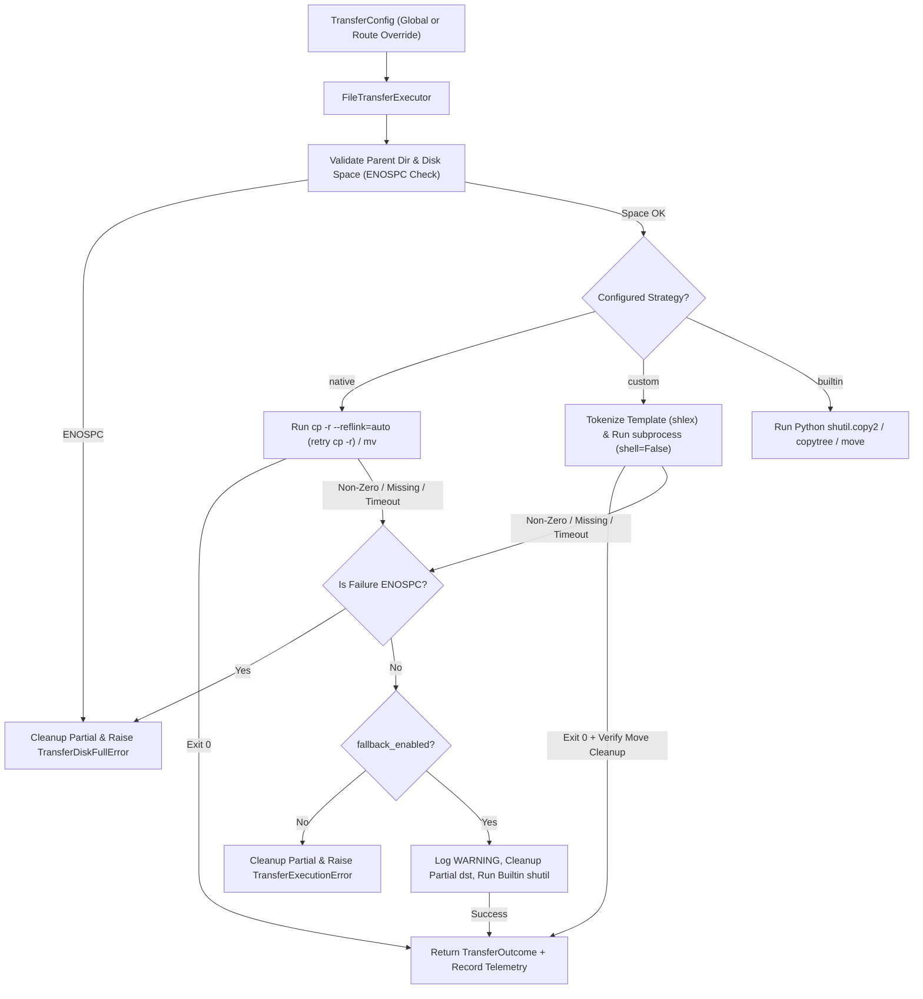

# Phase 1 Data Model: High-Speed OS-Native and Custom Utility File Transfers

**Feature**: `012-native-file-transfers`
**Date**: 2026-11-05
**Status**: Complete

---

## 1. Enumerations (`media_cron/transfer/models.py`)

### `TransferStrategy(StrEnum)`
Defines the configured or effective file transfer backend:
- `NATIVE = "native"` — Uses OS-native coreutils (`cp -r --reflink=auto` with fallback retry to `cp -r` for copies; `mv` for moves).
- `CUSTOM = "custom"` — Uses user-configured external command templates (`copy_command` / `move_command`).
- `BUILTIN = "builtin"` — Uses Python standard library streaming (`shutil.copy2`, `shutil.copytree`, `shutil.move`).

### `TransferAction(StrEnum)`
Defines the type of file transfer operation:
- `COPY = "copy"` — Duplicates a source file or directory tree to the destination while preserving the source.
- `MOVE = "move"` — Relocates a source file or directory tree to the destination and removes the source upon verified completion.

---

## 2. Configuration Entities

### `TransferConfig` (`media_cron/transfer/models.py`)
Immutable/validated dataclass representing global or per-destination file transfer settings.

| Field | Type | Default | Constraints & Validation |
|-------|------|---------|--------------------------|
| `strategy` | `TransferStrategy` | `TransferStrategy.NATIVE` | Must be one of `native`, `custom`, `builtin`. Automatically coerced from lowercase string. |
| `copy_command` | `str \| None` | `None` | Optional custom command template for `copy` operations (e.g., `"rsync -a {src} {dst}"`). If `strategy == CUSTOM` and `copy_command` is `None`, copy operations either fall back to `native`/`builtin` (if `fallback_enabled=True`) or raise `ValueError` during validation if neither `copy_command` nor `move_command` is provided when `strategy == CUSTOM`. Cannot contain unbalanced quotes (`shlex.split` check) or only one of `{src}` / `{dst}`. |
| `move_command` | `str \| None` | `None` | Optional custom command template for `move` operations (e.g., `"rsync -a --remove-source-files {src} {dst}"`). Validated with the same template rules as `copy_command`. |
| `fallback_enabled` | `bool` | `True` | When `True`, failed `native` or `custom` transfers (except `ENOSPC`) clean up partial destination artifacts and retry via `builtin` (`shutil`). When `False` (strict mode), failures raise `TransferExecutionError` immediately. |
| `timeout_seconds` | `float` | `3600.0` | Maximum allowed execution time in seconds for a single external utility invocation. Must be `> 0`. |

### Integration with Existing Config Models
1. **`MediaCronConfig` (`media_cron/config.py`)**:
   - Adds `transfer: TransferConfig = field(default_factory=TransferConfig)` to `MediaCronConfig`.
   - Loaded from top-level `transfer:` section in `config.yaml`, overridden by `MEDIA_CRON_TRANSFER_*` environment variables, and overridden by CLI flags (`--transfer-strategy`, `--copy-cmd`, `--move-cmd`, `--no-transfer-fallback`, `--transfer-timeout`).
2. **`DestinationEndpointConfig` (`media_cron/routing/models.py`)**:
   - Adds `transfer: TransferConfig | None = None` to allow per-route destination overrides (`routes.<media_type>.destination.transfer`). When partial keys are specified under a route's `destination.transfer` block, unspecified keys inherit from the global `MediaCronConfig.transfer`.

---

## 3. Runtime & Telemetry Entities (`media_cron/transfer/models.py`)

### `TransferOperation`
Represents an in-flight or planned file/directory transfer request.

| Field | Type | Description |
|-------|------|-------------|
| `src` | `Path` | Resolved source file or directory path. |
| `dst` | `Path` | Resolved destination file or directory path. |
| `action` | `TransferAction` | `COPY` or `MOVE`. |
| `configured_strategy` | `TransferStrategy` | The strategy requested by `TransferConfig` (`native`, `custom`, or `builtin`). |
| `dry_run` | `bool` | If `True`, logs and records the planned command without modifying the filesystem. |
| `source_bytes` | `int` | Total size in bytes of `src` prior to execution (`0` if `dry_run` and source does not yet exist on disk). |

### `TransferOutcome`
Immutable record returned by `FileTransferExecutor.copy()` / `FileTransferExecutor.move()` and recorded in telemetry.

| Field | Type | Description |
|-------|------|-------------|
| `src` | `Path` | Source path transferred. |
| `dst` | `Path` | Destination path written. |
| `action` | `TransferAction` | `COPY` or `MOVE`. |
| `configured_strategy` | `TransferStrategy` | Strategy originally configured (`native`, `custom`, `builtin`). |
| `effective_strategy` | `TransferStrategy` | Backend that actually completed the transfer (`native`, `custom`, or `builtin`). |
| `fallback_used` | `bool` | `True` if the primary external strategy failed and `builtin` fallback completed the transfer. |
| `fallback_reason` | `str \| None` | Diagnostic message explaining why fallback was triggered (e.g., binary not found, exit code, timeout), or `None`. |
| `command_executed` | `list[str] \| None` | Exact `argv` list executed (or planned during `dry_run`) for `native`/`custom` strategies; `None` when `builtin` is configured directly. |
| `bytes_transferred` | `int` | Total bytes copied or moved (`0` in `dry_run` if skipped). |
| `duration_ms` | `float` | Elapsed wall-clock time in milliseconds. |
| `throughput_mbps` | `float` | Effective transfer throughput in megabytes per second (`(bytes_transferred / (1024 * 1024)) / (duration_ms / 1000.0)`), or `0.0` when `duration_ms <= 0`. |
| `dry_run` | `bool` | Whether the operation ran in dry-run simulation mode. |

### `TransferSummary`
Aggregated batch-level transfer telemetry attached to `BatchSummary` (`media_cron/models.py` as `transfer_summary: TransferSummary`).

| Field | Type | Default | Description |
|-------|------|---------|-------------|
| `native_count` | `int` | `0` | Number of transfers completed via `native` (`cp`/`mv`). |
| `custom_count` | `int` | `0` | Number of transfers completed via `custom` user utilities. |
| `builtin_count` | `int` | `0` | Number of transfers completed via `builtin` (`shutil`), including fallbacks. |
| `fallback_count` | `int` | `0` | Number of transfers that fell back from `native`/`custom` to `builtin`. |
| `total_bytes_transferred` | `int` | `0` | Cumulative bytes transferred across all copy/move operations in the batch. |
| `total_duration_ms` | `float` | `0.0` | Cumulative transfer time in milliseconds across the batch. |

---

## 4. Domain Exceptions (`media_cron/transfer/models.py`)

- `TransferError(RuntimeError)` — Base exception for transfer engine failures.
- `TransferConfigError(ValueError)` — Raised when a `TransferConfig` or custom command template is invalid.
- `TransferDiskFullError(TransferError)` — Raised when destination storage lacks sufficient free space (`ENOSPC`); bypasses `builtin` fallback.
- `TransferTimeoutError(TransferError)` — Raised when an external transfer command exceeds `timeout_seconds` and fallback is disabled (or also fails).
- `TransferExecutionError(TransferError)` — Raised when a transfer fails and fallback is either disabled (`fallback_enabled=False`) or the fallback itself fails.

---

## 5. Entity Relationship & State Flow

